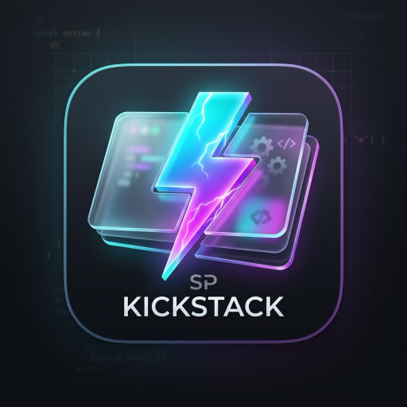
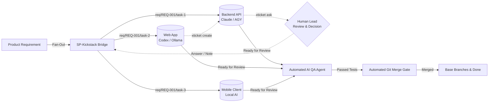
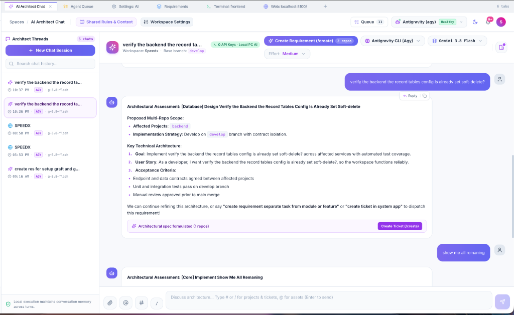
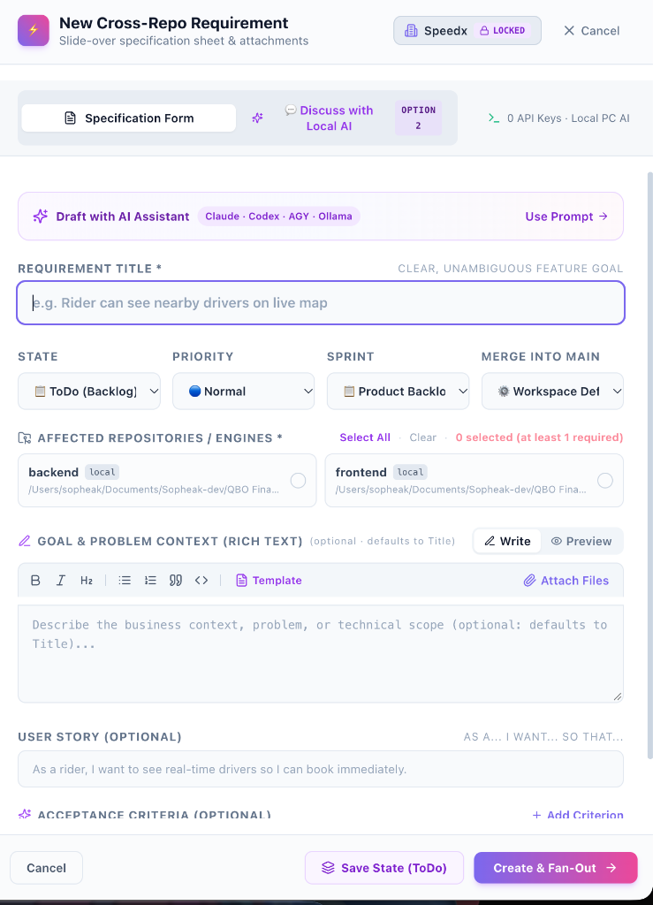
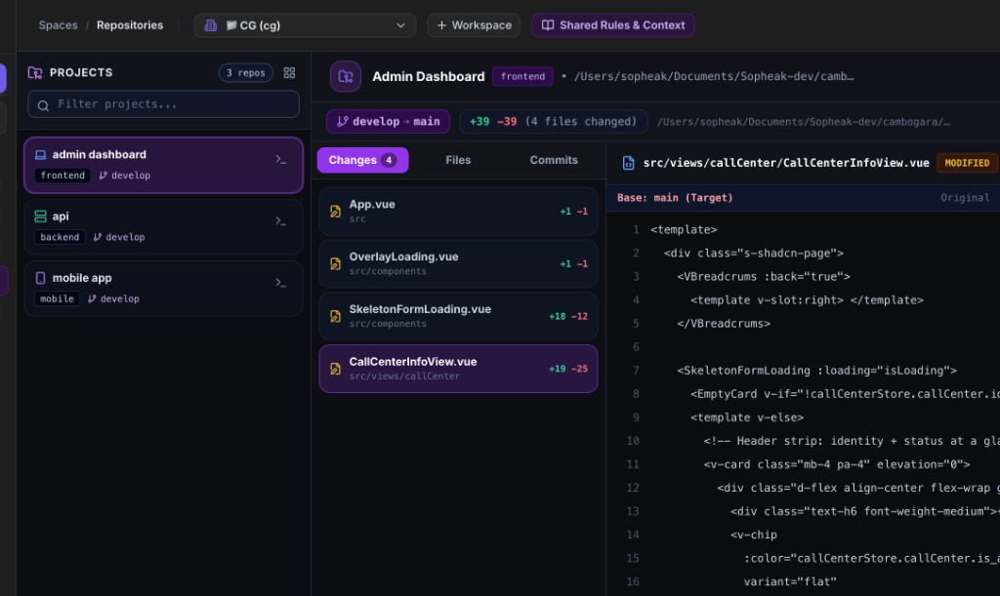
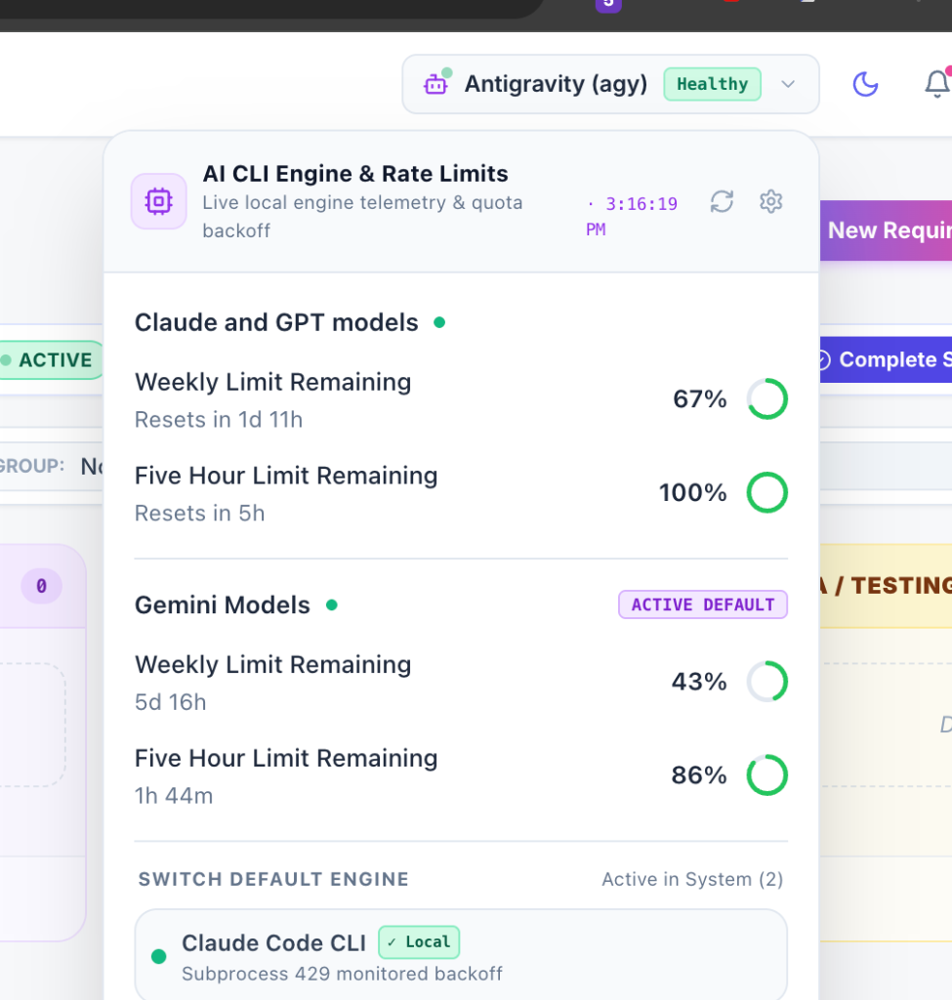
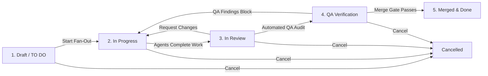

<div align="center">



# SP-Kickstack

**Cross-Repo AI Agent Orchestration Bridge & Human-in-the-Loop Git Workflow**

[](LICENSE)
[](package.json)
[](https://www.typescriptlang.org/)
[](https://react.dev/)
[](https://tauri.app/)
[](https://tailwindcss.com/)
[](packages/)

[**Quick Start**](#-quick-start) •
[**Screenshots**](#-system-screenshots) •
[**Key Features**](#-key-features) •
[**Architecture**](#-architecture--lifecycle) •
[**AI CLI Engines**](#-supported-local-ai-cli-engines) •
[**xticket CLI**](#-human-in-the-loop-agent-cli-xticket) •
[**Documentation**](#-documentation--guides) •
[**Contributing**](#-contributing)

</div>

---

## 🌟 Overview

Modern software development spans multiple distributed repositories: web applications, backend APIs, mobile clients, shared packages, and microservices. 

While autonomous AI coding agents (**Claude Code**, **Google Antigravity / Gemini CLI**, **OpenAI Codex**, and **Ollama**) excel within a single codebase, coordinating them across multiple repositories has historically been a manual, fragmented process.

**SP-Kickstack** is an open-source orchestration bridge that connects high-level product requirements with local developer AI CLIs across multiple git repositories. It coordinates tasks on isolated git branches, connects autonomous agents with human operators for blocking questions, conducts automated pre-merge AI QA audits, and enforces automated git merge gates.



---

## 📸 System Screenshots

### 1. AI Architect Chat & Spec Formulation
Collaborative conversational workspace to draft comprehensive product requirements, stream live AI reasoning, switch models on the fly, and inspect generated task specifications.

<p align="center">
  
</p>

### 2. Cross-Repository Requirement Fan-Out
Slide-over drawer to configure target repositories across your monorepo or polyrepo landscape, configure execution models, customize base branches, and set merge gate policies.

<p align="center">
  
</p>

### 3. Multi-Repository Git Review & Diffs
Visual code diff inspector displaying syntax-highlighted changes, branch status, review annotations, and one-click **"Improve with AI"** actionable change requests.

<p align="center">
  
</p>

### 4. Live AI CLI Telemetry & Rate-Limit Backoff
Live monitor tracking provider token limits, HTTP 429 rate limit backoff timers, and automated retry sweeps across Claude, Gemini/Antigravity, Codex, and Ollama.

<p align="center">
  
</p>

---

## ✨ Key Features

### 🌐 Cross-Repository Fan-Out & Dependency Linking
- **Single Requirement, Multiple Repos**: Write a feature specification once and fan out scoped tasks across backend, frontend, and mobile repositories.
- **Dynamic Sibling Tickets**: Agents working in one repository can dynamically discover missing contracts and spawn dependent tasks in other repositories via `xticket create`.
- **Dependency Topology**: Tasks pause automatically until prerequisite sibling tickets reach review or merge completion.

### 🤖 Supported Local AI CLI Engines
- **Zero Cloud Lock-in**: Leverages developer CLI tools already installed on your machine (`claude`, `agy`, `codex`, `ollama`), plus an offline heuristic spec generator.
- **Dynamic Switching & Reasoning Control**: Adjust providers, model presets, and reasoning effort levels (`low`, `medium`, `high`, `max`) per requirement or per task.
- **Built-in Rate Limit Backoff**: Automatically detects HTTP 429 rate limits, pauses affected tasks until the provider window resets, and triggers automated retry sweepers.

### 🙋‍♂️ Human-in-the-Loop (`xticket` CLI)
- **Interactive Question Handling**: When an agent encounters ambiguous requirements, missing assets, or design dilemmas, it calls `xticket ask` to pause execution and present interactive single-choice or multiple-choice questions in the dashboard.
- **Live Operator Notes**: Send real-time guidance, additional context, or course corrections directly to running agents without restarting their workspace.

### 🛡️ Git Branch Governance & Automated Merge Gate
- **Isolated Work Branches**: Every task executes on its own branch (e.g. `req/<REQ-ID>/task-<id>`).
- **Pre-Merge Test Verification**: Before merging to `main` or development branches, the bridge performs dry-run merges in temporary repository clones and executes local test suites.
- **Visual Diff Review**: Inspect file diffs, leave line-by-line review comments, and click **"Improve with AI"** to formulate actionable agent instructions before requesting changes.

### 🧪 Autonomous Pre-Merge AI QA Agent
- **Automated Verification**: Runs an AI QA specialist across changed task branches before merge.
- **Structured Findings**: Automatically categorizes code review findings into `blocker`, `major`, or `minor` issues.
- **Pass/Fail Verdicts**: Collects QA summaries and automated verdicts (`xticket qa-result`) with multi-round change tracking.

### 💬 Interactive AI Chat & Spec Architect
- **Conversational Requirement Formulation**: Brainstorm architecture and user stories in an interactive chat stream.
- **Context Mentions**: Use `@assets` to attach design tokens or schemas, `#projects` / `#requirements` to reference repositories and tickets, and `/create` to synthesize discussion into structured requirement tickets.
- **Instant Optimistic Rendering**: Prompts and file attachments render immediately with live execution progress indicators.

### 🧭 In-App Browser with AI Grounding
- **Side-by-Side Web Workspace**: Integrated browser workspace with persistent state across tabs.
- **Contextual Grounding**: Feeds active webpage URLs, DOM headings, text content, and screenshots directly into the AI prompt for grounded architectural design.

### 🖥️ Native Desktop (Tauri v2) & Web Support
- **Full-Featured Web Dashboard**: Modern React 18 single-page application styled with Tailwind CSS and Radix UI.
- **Native Desktop App**: Packaged with Tauri v2 for macOS, Linux, and Windows, bundling the Node.js backend sidecar and local SQLite database into a lightweight native binary.

---

## 🏛️ Architecture & Lifecycle

### The Requirement Lifecycle



### System Architecture

```
┌─────────────────────────────────────────────────────────────┐
│                     User Interfaces                         │
│   Web Dashboard (React + Vite)   │   Tauri v2 Desktop App   │
└──────────────────────────────┬──────────────────────────────┘
                               │ HTTP / SSE / Tauri IPC
┌──────────────────────────────▼──────────────────────────────┐
│                    SP-Kickstack Server                      │
│   • Express REST API (:4100)      • Task Reactor & Scheduler│
│   • SQLite Database (better-sqlite3) • Git Branch & Merge Gate│
│   • Multi-Workspace Isolation     • Rate Limit Sweeper      │
└──────────────┬──────────────────────────────┬───────────────┘
               │ Process Exec / Stdin         │ CLI Invocation
┌──────────────▼──────────────┐┌──────────────▼───────────────┐
│     Local AI CLI Engines    ││         xticket CLI          │
│ • Claude Code (`claude`)    ││ • xticket ask (questions)    │
│ • Google AGY / Gemini CLI   ││ • xticket note (live notes)  │
│ • OpenAI Codex (`codex`)    ││ • xticket create (tickets)   │
│ • Ollama (local LLMs)       ││ • xticket qa-result (verdict)│
└─────────────────────────────┘└──────────────────────────────┘
```

---

## 📦 Monorepo Structure

```
SP-Kickstack/
├── packages/
│   ├── shared/       # Shared TypeScript types, Zod schemas, & validation utilities
│   ├── server/       # Express REST API, SQLite database, Git bridge, & AI services
│   ├── web/          # React 18, Vite, Tailwind CSS, & Radix UI dashboard
│   ├── desktop/      # Tauri v2 native desktop application wrapper & sidecar
│   └── xticket/      # CLI tool invoked by AI agents inside repositories
├── docs/             # Complete architecture specs, user guides, and tutorials
├── scripts/          # Development orchestration, database seeders, & build scripts
└── package.json      # Monorepo root configuration
```

---

## 🚀 Quick Start

### Prerequisites

- **Node.js**: `v22.19.0` (pinned in `.nvmrc` for native `better-sqlite3` bindings).
- **Git**: Installed and available in your `PATH`.
- **Package Manager**: `npm` (included with Node.js).
- *(Optional)* One or more developer AI CLIs:
  - [Claude Code](https://docs.anthropic.com/en/docs/agents-and-tools/claude-code/overview) (`npm i -g @anthropic-ai/claude-code`)
  - [Google Antigravity / Gemini CLI](https://github.com/google-gemini) (`agy`)
  - [OpenAI Codex CLI](https://github.com/openai) (`codex`)
  - [Ollama](https://ollama.ai/) (local models such as `llama3`, `qwen2.5-coder`)

### 1. Clone & Install

```bash
# Clone the repository
git clone https://github.com/your-org/sp-kickstack.git
cd sp-kickstack

# Ensure correct Node.js version
nvm use 22.19.0

# Install all workspace dependencies
npm install

# Build all packages (shared, server, web, xticket)
npm run build
```

### 2. Run the Web Development Stack

```bash
# Starts the bridge server on http://localhost:4100
# and the Vite web dashboard on http://localhost:4101
npm run dev
```

Open your browser to [http://localhost:4101](http://localhost:4101).

### 3. Run the Desktop App (Tauri v2)

```bash
# Bundle the server sidecar
npm run desktop:bundle-server

# Launch the desktop app in development
npm run desktop:dev

# Build a production native installer (macOS .dmg / Windows .msi / Linux .deb)
npm run desktop:build
```

---

## 🤖 Supported Local AI CLI Engines

SP-Kickstack detects and communicates directly with the developer AI CLIs installed on your local machine.

| Engine ID | CLI Binary | Default Model | Configuration Guide |
|---|---|---|---|
| `claude-cli` | `claude` | `claude-3-7-sonnet` | [AI Engine Guide](docs/guide/ai-engine-guide.md) |
| `agy-cli` | `agy` | `gemini-2.5-pro` | [AI Engine Guide](docs/guide/ai-engine-guide.md) |
| `codex-cli` | `codex` | `o3-mini` | [AI Engine Guide](docs/guide/ai-engine-guide.md) |
| `ollama` | `ollama` | `qwen2.5-coder` / `llama3.3` | [AI Engine Guide](docs/guide/ai-engine-guide.md) |
| `heuristic` | *built-in* | Rule-Based Offline Spec Generator | Always available offline |

> [!TIP]
> You can configure paths, models, and reasoning effort levels in the dashboard under **Settings → AI CLI Engines**, or override them per requirement in **Run Settings**.

---

## 🛠️ Human-in-the-Loop Agent CLI (`xticket`)

Inside task repositories, agents have access to the `xticket` CLI to coordinate across repositories and communicate with human operators.

### Asking a Blocking Question
When an agent needs human decision-making:
```bash
xticket ask \
  --title "Choose authentication strategy" \
  --options '["JWT Bearer Tokens", "Session Cookies with Redis", "OAuth2 PKCE"]'
```
*The agent pauses execution until the human selects an option in the dashboard.*

### Sending a Live Note or Progress Update
```bash
xticket note --message "Database migration complete. Proceeding with service layer refactoring."
```

### Spawning a Sibling Repository Task
```bash
xticket create \
  --project "backend-api" \
  --title "Add POST /api/v1/auth/tokens endpoint" \
  --body "Web client requires token exchange endpoint supporting refresh flow."
```

### Submitting AI QA Verdict
```bash
xticket qa-result \
  --passed \
  --summary "All 42 integration tests passed. Zero accessibility violations found."
```

---

## 📚 Documentation & Guides

Comprehensive documentation is available in the [`docs/`](docs/) directory:

| Guide | Description |
|---|---|
| 📘 [**01 Getting Started**](docs/guide/01-getting-started.md) | Installation, first project setup, and initial requirement execution. |
| 📁 [**02 Projects & Engines**](docs/guide/02-projects-and-engines.md) | Connecting local git repositories and configuring execution engines. |
| 🚀 [**03 Requirements & Fan-Out**](docs/guide/03-requirements-and-fan-out.md) | Writing multi-repo requirements, sprint planning, and fan-out mechanics. |
| 🎟️ [**04 Agents, Tickets & xticket**](docs/guide/04-agents-tickets-and-questions.md) | Agent task lifecycle, dependency linking, and `xticket` commands. |
| ❓ [**05 Answering Questions & Notes**](docs/guide/05-answering-questions-and-notes.md) | Responding to agent dilemmas and injecting real-time operator notes. |
| 🔍 [**06 Review, QA & Merge Gate**](docs/guide/06-review-qa-and-merge.md) | Inspecting diffs, AI QA rounds, and automated test-gated merging. |
| 🔔 [**07 Notifications & Webhooks**](docs/guide/07-notifications.md) | Configuring real-time alerts for Slack, Telegram, and custom webhooks. |
| ⏳ [**08 Rate Limits & Auto-Retry**](docs/guide/08-rate-limits-and-retry.md) | Understanding HTTP 429 backoff windows and retry sweeper schedules. |
| ⚙️ [**09 Settings & Environment**](docs/guide/09-settings-and-environment.md) | Full reference manual for workspace settings, themes, and safety limits. |
| 🩺 [**10 Troubleshooting**](docs/guide/10-troubleshooting.md) | Solutions for common git lock issues, database migrations, and port conflicts. |
| 📐 [**DevFlow Bridge Specification**](docs/devflow-bridge-spec.md) | Full technical architecture and protocol specification (v0.2). |

---

## 🧪 Testing & Verification

SP-Kickstack maintains test suites across unit, integration, and API boundary levels.

```bash
# Run unit and integration tests across all workspaces
npm test

# Run tests in watch mode
npm run test:watch

# Run TypeScript typechecks and verification
npm run verify
```

---

## 🤝 Contributing

We welcome contributions from the open-source community! Whether you want to add support for a new AI CLI engine, enhance merge gate strategies, or improve the UI, here is how you can help:

1. **Fork the Repository** on GitHub.
2. **Create a Feature Branch**:
   ```bash
   git checkout -b feature/awesome-feature
   ```
3. **Commit Your Changes**: Follow clear commit conventions.
4. **Ensure Verification Passes**:
   ```bash
   npm run verify
   ```
5. **Open a Pull Request** with a detailed explanation of your changes.

Please refer to our [Code of Conduct](CODE_OF_CONDUCT.md) and guidelines when contributing.

---

## 📄 License

SP-Kickstack is open-source software licensed under the [MIT License](LICENSE).
