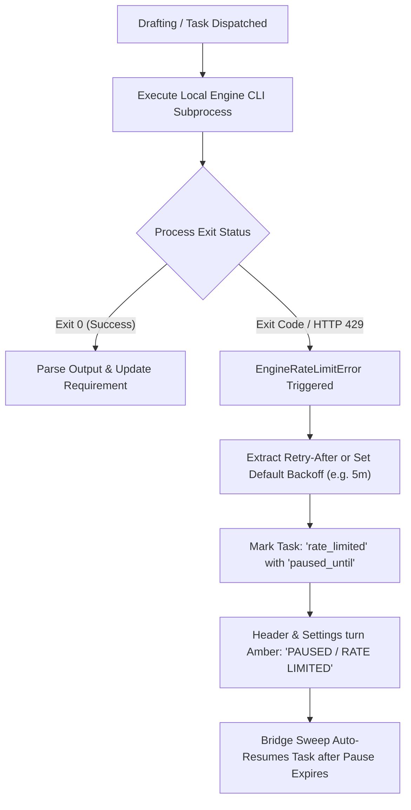

# SP-Kickstack: Local AI CLI Engine & Rate Limit Management Guide

This guide explains how to configure, monitor, and use **Local AI CLI Engines** in SP-Kickstack.

---

## 1. Overview & Core Philosophy

SP-Kickstack bridges product requirements and multi-project git workflows using **100% local AI CLIs**. 

### Key Principles:
- **Zero API Keys Required**: No cloud API tokens, OpenAI keys, or Anthropic secrets are stored or needed.
- **Your Existing CLI Credentials**: SP-Kickstack dispatches commands directly to CLI binaries already authenticated on your machine (`claude`, `agy`, `codex`, or `ollama`).
- **Resilient Bridge Quota Monitoring**: When an engine CLI experiences an HTTP 429 rate limit or token freeze, SP-Kickstack automatically detects it, pauses task dispatches with backoff, and resumes when the quota window resets.
- **Header Quick Access**: View active engine health and switch engines in one click from anywhere in the application.

---

## 2. Supported Local Engines

SP-Kickstack supports five distinct engine options:

| Engine | Command / Protocol | Rate Limit Handling | Best Used For |
| :--- | :--- | :--- | :--- |
| **Claude Code CLI** | `claude -p --model <id>` | Bridge Monitored (429 Backoff) | Complex full-stack architectures, deep code review, detailed PR descriptions. |
| **Google AGY CLI** | `agy -p --model <id>` | Bridge Monitored (429 Backoff) | Rapid multi-step planning, agentic workflows, Gemini 2.5 / 3.8 models. |
| **OpenAI Codex CLI** | `codex exec` | Bridge Monitored (429 Backoff) | Targeted script generation, ticket-to-code synthesis. |
| **Local Ollama** | HTTP `127.0.0.1:11434` | **100% Offline (Unlimited)** | Air-gapped environments, local GPU models (`deepseek-r1`, `llama3.3`, `qwen2.5-coder`). |
| **Built-in Heuristic** | Internal TypeScript Rules | **100% Offline (Zero Latency)** | Instant requirement drafting without any external AI tooling installed. |

---

## 3. How Local PC Engine Detection Works

When SP-Kickstack runs, the backend automatically scans your machine to find installed CLI binaries:

1. **Path Discovery**:
   The server inspects your environment `$PATH` along with standard developer tool locations:
   - `~/.local/bin`
   - `/usr/local/bin`
   - `/opt/homebrew/bin`
   - `~/.npm-global/bin`
   - `~/.cargo/bin`

2. **Symlink Validation**:
   Symlinks are resolved using `fs.realpathSync`. Broken symlinks (e.g., from uninstalled macOS apps) are filtered out to prevent dispatch errors.

3. **Status Badges**:
   - `✓ Installed on PC`: The binary was found and is executable. Its detected filesystem path is displayed.
   - `✕ Not Detected`: The binary was not found in PATH or standard folders. An installation tip is shown.

---

## 4. Understanding AI CLI Rate Limits & Quotas

### Why Don't Local CLIs Have a `--rate-limit` Command?
Local AI CLIs (`claude`, `agy`, `codex`) authenticate using your active interactive browser login or session tokens. They do **not** expose an interactive command-line quota query flag.

### How SP-Kickstack's Studio Bridge Handles Rate Limits:
Instead of relying on guesswork, SP-Kickstack's bridge implements **Subprocess Stream Interception**:



1. **Detection**: The bridge inspects process stdout, stderr, and exit codes for rate limit patterns (`rate limit reached`, `429`, `quota exceeded`, `temporarily locked`).
2. **Backoff Timestamp**: A `paused_until` ISO timestamp is set in the database.
3. **Queue Protection**: Subsequent dispatches to the same engine are held in queue to prevent burning extra tokens or thrashing the CLI.
4. **Automated Recovery**: Once `paused_until` expires, the bridge automatically retries queued tasks.

---

## 5. Configuring Engines in Settings

To configure your default engine and model preferences:

1. Navigate to **Settings** (`/settings`) from the left sidebar.
2. Select the **AI & Local Engines** tab.

### A. Selecting the Default Engine
- Choose one of the 5 cards: **Claude Code CLI**, **Google AGY CLI**, **OpenAI Codex CLI**, **Local Ollama**, or **Built-in Heuristic**.
- Each card displays:
  - Detection status (`✓ Installed on PC` with path, or `✕ Not Detected`).
  - Rate limit capability (`🛡️ 429 Monitored` vs `⚡ Unlimited`).
- **Warning Banner**: If you select an engine that is not installed on your machine, a yellow warning banner appears with instructions on how to install it or configure a custom binary path.

### B. Configuring CLI Model & Reasoning Effort
For each CLI, you can configure:
- **Model Preset or Manual ID**: Choose from curated models (e.g. `Opus 5.5`, `Sonnet 5`, `Gemini 3.8 Flash`, `DeepSeek R1`) or click **Enter manual ID** to pass custom model strings.
- **Reasoning Effort**: Set thinking depth (`Low`, `Medium`, `High`, `Max`).
- **Custom Executable Path**: If your binary is installed in an unusual path (e.g. `/my/tools/bin/claude`), paste the absolute path into the **Custom Binary Path** field.
- **Ollama URL**: Default is `http://127.0.0.1:11434`. Change this if Ollama is hosted in Docker or on a remote machine.

Click **Save AI CLI Settings** to persist your configuration.

---

## 6. Live Engine Rate Limit & Telemetry Monitor

Located inside the **AI & Local Engines** settings tab, the **Engine Rate Limit & Telemetry Diagnostics** card provides a live overview of all 5 engines:

| Column | Description |
| :--- | :--- |
| **Engine** | Name of the engine and whether it is currently set as `DEFAULT`. |
| **Local Detection** | Detected executable path on your system (`~/.local/bin/...`) or `Not detected`. |
| **Rate Limit Mode** | `Bridge 429 Backoff` (cloud CLI) or `100% Offline (Unlimited)` (hardware). |
| **Quota Health** | Current status: `HEALTHY` (green), `PAUSED` (amber/red), or `UNLIMITED` (cyan). |
| **Dispatches** | Total number of bridge tasks dispatched to this engine. |
| **Active** | Number of tasks currently running or pending execution. |
| **429 Pauses** | Cumulative count of rate limit backoff events encountered. |

Click the **Refresh** button at any time to query the latest metrics from the bridge database.

---

## 7. Header Quick View & 1-Click Engine Switcher

You can monitor and switch AI engines from anywhere in SP-Kickstack without opening Settings.

### Header Indicator
Look at the top-right of the application header (next to the Light/Dark mode toggle):
- **Bot Icon + Status Dot**:
  - 🟢 **Pulsing Green**: Engine is healthy, installed, and ready.
  - 🟡 **Pulsing Amber**: Engine is currently paused due to an HTTP 429 rate limit.
  - 🔵 **Pulsing Cyan**: Unlimited local execution (Ollama or Heuristic).
  - ⚪ / 🔴 **Gray / Red**: Selected engine is missing or not installed on this PC.
- **Engine Name & Pill**: Displays the current engine name (e.g. `Claude Code`) and status (e.g. `Healthy`, `Rate Limited`, `Unlimited Local`, or `CLI Missing`).

### Header Popover Features
Click the header indicator to open the **Radix UI Quick View Popover**:
1. **Active Engine Summary**: Displays the discovered executable path and live rate limit explanation.
2. **Telemetry Counters**: Quick glance at total Dispatches, Completed tasks, Active tasks, and 429 Events.
3. **1-Click Engine Switcher**:
   - Lists all 5 engines with live local detection status (`✓ Local` vs `Not Detected`).
   - Click any engine to switch your default drafting engine immediately.
   - Shows an instant toast notification and updates the bridge without reloading.
4. **Full AI Configuration Link**: Click to jump directly to the Settings AI tab.

---

## 8. CLI Installation & Setup Reference

If an engine shows `✕ Not Detected`, use the terminal commands below to install it on your machine:

### 1. Claude Code CLI (`claude`)
Requires Node.js 18+:
```bash
npm install -g @anthropic-ai/claude-code
claude --version
```
*Run `claude` once in your terminal to complete interactive authentication with Anthropic.*

### 2. Google Antigravity CLI (`agy`)
Installed via the Google Antigravity Developer SDK:
```bash
# Verify installation
which agy
agy --version
```
*Ensure `~/.local/bin` or your Antigravity SDK bin directory is in your `$PATH`.*

### 3. OpenAI Codex CLI (`codex`)
Requires Node.js 18+:
```bash
npm install -g @openai/codex
codex --version
```

### 4. Local Ollama (`ollama`)
macOS / Linux:
```bash
# Install via official installer
curl -fsSL https://ollama.com/install.sh | sh

# Or on macOS with Homebrew:
brew install ollama

# Start the Ollama server:
ollama serve

# Pull your preferred coding model:
ollama pull llama3.2
ollama pull deepseek-r1:14b
ollama pull qwen2.5-coder:32b
```

### 5. Built-in Offline Heuristic
No external tools or commands are needed. The heuristic engine is compiled directly into the SP-Kickstack server core and runs instantly even without internet access.

---

## 9. Troubleshooting & FAQ

#### Q: The header shows "CLI Missing", but I know I have the tool installed.
**A**: Your CLI might be installed in a path not in standard environment `$PATH` (e.g. within a custom `nvm`, `pyenv`, or `asdf` directory).
1. Run `which claude` (or `which agy`) in your terminal to find the absolute path.
2. Open **Settings > AI & Local Engines**.
3. Under the engine's configuration card, paste the path into **Custom Binary Path** (e.g., `/Users/yourname/.nvm/versions/node/v22.19.0/bin/claude`).
4. Click **Save AI CLI Settings**.

#### Q: An engine shows "PAUSED / RATE LIMITED". How do I resume tasks?
**A**: When an engine reaches a 429 limit, the bridge automatically sets a pause timer (typically 2 to 5 minutes depending on the CLI). Once the pause window expires, the bridge automatically retries the task. Alternatively, you can use the **Header Quick Switcher** to switch to another engine (such as **Ollama** or **Built-in Heuristic**) with zero downtime.

#### Q: Can I run Ollama on a different computer or GPU server?
**A**: Yes! In **Settings > AI & Local Engines > Local Ollama Settings**, update the **Ollama Instance URL** to point to your GPU server's address (e.g. `http://192.168.1.100:11434`).
