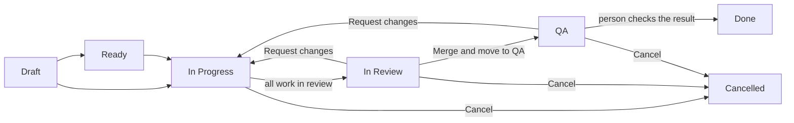

# SP Kickstack user guide

SP Kickstack (the "DevFlow Bridge") turns one written requirement into work for AI coding
agents in several repositories, and keeps people in charge of questions, review, merge and QA.

This guide is for the people who use it every day: tech leads and developers who write
requirements, watch agents work, review, merge and test. It also covers what whoever sets up
projects and engines needs to know.

## The lifecycle in five minutes

1. **You write a requirement.** You describe what you want and pick the projects
   (repositories) it affects. It starts as a draft, shown as **TO DO**.
2. **You press Start Fan-Out.** The bridge sends one goal to each affected project's engine.
   Each goal works on its own git branch, named after the requirement, `<REQ-ID>`
   (for example `REQ-007`). The requirement is now **In Progress**.
3. **Agents work.** If an agent needs something from another project, it files a ticket
   (`xticket create`). If it needs a decision from a person, it asks a question
   (`xticket ask`) and pauses until you answer. You can also send a running agent a **Note**.
4. **All work is ready for review.** When every task is in review, the requirement moves to
   **In Review** on its own. You look at the changes, leave comments, and either
   **Request changes** (the agents run again on the same branches) or merge.
5. **Merge & move to QA.** The bridge merges every task branch in a temporary copy of each
   repository, runs the project's test command, pushes, and moves the requirement to **QA**.
   With the **Auto-merge (no review)** policy this step starts by itself.
6. **You test and finish.** When QA passes, you move the requirement to **Done**. If QA finds a
   problem, you can still **Request changes** from QA.

You can **Cancel** a requirement at any open stage.

## Where people act

| Stage | What you do | Page |
|---|---|---|
| Draft / Ready | Write and edit the requirement, then **Start Fan-Out** | [Requirements and fan-out](03-requirements-and-fan-out.md) |
| In Progress | Answer agent questions, send notes, **Retry** stopped tasks | [Answering questions and notes](05-answering-questions-and-notes.md), [Rate limits and Retry](08-rate-limits-and-retry.md) |
| In Review | Review the changes, comment, **Request changes** or **Merge & move to QA** | [Review, QA and merge](06-review-qa-and-merge.md) |
| QA | Test the merged result, **Request changes** if needed, move to **Done** | [Review, QA and merge](06-review-qa-and-merge.md) |
| Any open stage | **Cancel** | [Requirements and fan-out](03-requirements-and-fan-out.md) |

## Status names you will see

The guide uses short names. The app shows these labels:

| Guide name | Badge | Board column | State select on the requirement page |
|---|---|---|---|
| Draft (To Do) | TO DO | TO DO / DRAFT | State: ToDo |
| Ready | READY | READY FOR DISPATCH | — |
| In Progress | IN PROGRESS | IN PROGRESS | State: In-Progress |
| In Review | IN REVIEW | IN REVIEW | shows State: QA / Review |
| QA | QA / TESTING | QA / TESTING | State: QA / Review |
| Done | COMPLETE | COMPLETE | State: Done |
| Cancelled | CLOSED | — | — |

Task badges (PENDING, QUEUED, WAITING / HELD, NEEDS HUMAN, RATE LIMITED, FAILED and others) are
explained in [Requirements and fan-out](03-requirements-and-fan-out.md#task-statuses).

## Words used in this guide

- **Requirement**: one piece of work you describe, with an id such as `REQ-007`.
- **Project**: one repository registered in the bridge (sidebar **Repositories**).
- **Engine**: the system that runs the agents for a project — **Local AI CLI** (Claude Code, Google AGY, OpenAI Codex, Ollama), **Manual** (human developer workflow), or **Stoneforge** (HTTP engine).
- **Task**: one unit of work the bridge tracks. A **goal** is the task fan-out creates for a
  project. A **ticket** is a task one agent files for another project.
- **Link** (dependency): "task A waits for task B". Blocking tickets and questions create links.

## Pages

| Page | What it covers |
|---|---|
| [01 Getting started](01-getting-started.md) | Install, start, desktop app, demo, first project, first requirement, where data lives |
| [02 Projects and engines](02-projects-and-engines.md) | Register projects, Local AI CLI, Manual, and Stoneforge engines, engine health, `projects.yaml` |
| [03 Requirements and fan-out](03-requirements-and-fan-out.md) | Write a requirement, Start Fan-Out, task statuses, the Agent Queue, moves you may make, Cancel, Mark Done |
| [04 Agents, tickets and questions](04-agents-tickets-and-questions.md) | For whoever configures agents: `xticket create`, `xticket ask`, outbox, env vars |
| [05 Answering questions and notes](05-answering-questions-and-notes.md) | Answer agent questions, Let the agent decide, send a Note |
| [06 Review, QA and merge](06-review-qa-and-merge.md) | Review comments, Request changes, merge policies, Merge & move to QA, QA to Done |
| [07 Notifications](07-notifications.md) | Bell, toasts, Slack, Telegram and webhook channels |
| [08 Rate limits and Retry](08-rate-limits-and-retry.md) | RATE LIMITED, automatic resume, start limit, Retry, automatic retries |
| [09 Settings and environment](09-settings-and-environment.md) | Every Settings tab and every environment variable |
| [10 Troubleshooting](10-troubleshooting.md) | Common error messages and what to do |

The sidebar also features:
- **Agent Queue**: Live overview of all active and pending agent tasks in the workspace.
- **AI Architect Chat**: Interactive chat stream for conversational requirement drafting, code review, and 1-click `/create` ticket synthesis.
- **In-App Browser**: Grounded web workspace feeding live URLs, DOM headings, text content, and screenshots directly into AI prompts.
- **Attachments Hub**: Shared design tokens, API contracts, and schema assets available to agents across the workspace.
- **Telemetry & Sprints**: Agile sprint management, velocity tracking, and timing metrics.

## More guides

- [Complete Settings & Configuration Guide](settings-guide.md): every Settings module in detail, with parameter tables.
- [Local AI CLI Engine & Rate Limit Management Guide](ai-engine-guide.md): the local AI CLI engines (Claude Code, Google AGY, OpenAI Codex, Ollama, built-in heuristic), how they are detected, rate-limit handling and the header engine quick view.

Technical background: [DevFlow Bridge specification](../devflow-bridge-spec.md) and [spike results](../spike-results.md).
