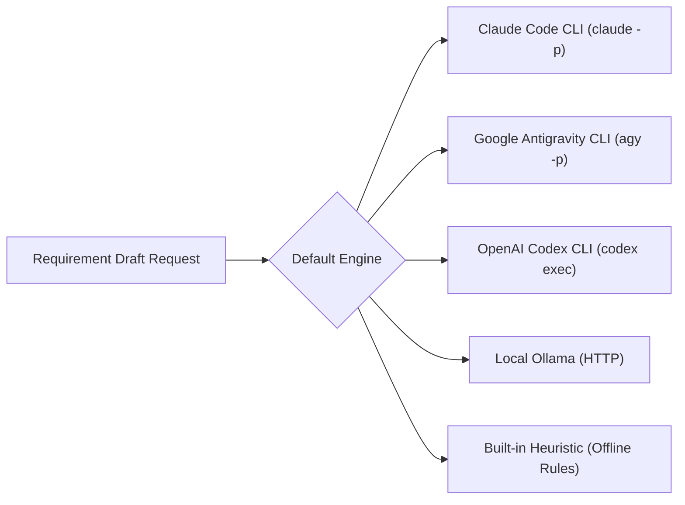
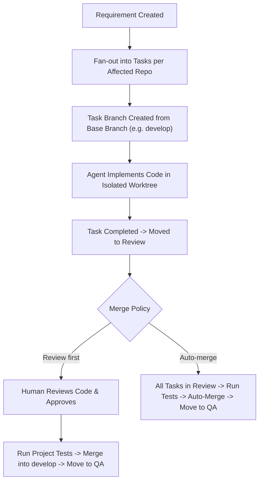

# SP-Kickstack: Complete Settings & Configuration Guide

> **Official User Manual & Administrator Reference**  
> *This documentation is publication-ready for the product website, user documentation portal, and onboarding manuals.*

---

## Table of Contents
1. [Overview](#1-overview)
2. [Module 1: AI & Local Engines](#2-module-1-ai--local-engines)
   - [Default AI Engine Selection](#default-ai-engine-selection)
   - [Live Rate Limit & Telemetry Diagnostics](#live-rate-limit--telemetry-diagnostics)
   - [Claude Code CLI Configuration](#claude-code-cli-configuration)
   - [Google Antigravity CLI Configuration](#google-antigravity-cli-configuration)
   - [OpenAI Codex CLI Configuration](#openai-codex-cli-configuration)
   - [Local Ollama Instance Configuration](#local-ollama-instance-configuration)
   - [Built-in Heuristic Engine](#built-in-heuristic-engine)
3. [Module 2: Git & Branch Merge Strategy](#3-module-2-git--branch-merge-strategy)
   - [Default Implementation Base Branch](#default-implementation-base-branch)
   - [Merge Policies: Review-First vs. Auto-Merge](#merge-policies-review-first-vs-auto-merge)
   - [Branch Isolation & Test Validation Rules](#branch-isolation--test-validation-rules)
4. [Module 3: Embedded IDE (VS Code / code-server)](#4-module-3-embedded-ide-vs-code--code-server)
   - [In-App Code & Diff Review](#in-app-code--diff-review)
   - [Server Lifecycle Control](#server-lifecycle-control)
   - [Port, Binary Path, and External URL Options](#port-binary-path-and-external-url-options)
5. [Module 4: Appearance & Color Themes](#5-module-4-appearance--color-themes)
6. [Module 5: Safety & System Governance Limits](#6-module-5-safety--system-governance-limits)
7. [Header Quick View & On-The-Fly Switching](#7-header-quick-view--on-the-fly-switching)
8. [Best Practices, Operational Rules & FAQ](#8-best-practices-operational-rules--faq)

---

## 1. Overview

The **Bridge Settings & Engine Control** screen (`/settings`) is the administrative control center of SP-Kickstack. It allows engineering teams and developers to configure:
- Local AI model routing, reasoning depths, and local hardware execution.
- Multi-repository git branch workflows and merge approval policies.
- In-app embedded code review servers (VS Code / code-server).
- User interface appearance themes.
- Autonomous loop prevention guards and system execution boundaries.

All settings are persisted in the local SQLite database (`bridge.db`) with zero external cloud dependencies.

### Direct Deep Linking & Tab State Persistence

The Settings screen supports URL query parameter synchronization (`?tab=<id>`). This provides:
- **Instant Deep-Linking**: Share or bookmark direct links to specific settings panels:
  - AI Engines: `/settings?tab=ai`
  - Git & Branch Merge Strategy: `/settings?tab=git`
  - Embedded IDE: `/settings?tab=ide`
  - Appearance: `/settings?tab=appearance`
  - Safety & Governance: `/settings?tab=safety`
- **Browser History Support**: Navigating between tabs records history entries, allowing you to use your browser's **Back** and **Forward** buttons seamlessly.
- **Reload Persistence**: Refreshing the browser preserves the active settings tab without resetting to the default tab.
- **Header Integration**: Clicking configuration buttons in the top navbar (such as the AI Engine quick view popover) deep-links directly into `/settings?tab=ai`.


---

## 2. Module 1: AI & Local Engines

**Path**: `Settings > AI & Local Engines`  
**Philosophy**: 100% Local · Zero Cloud API Keys · Session-Based Authentication

SP-Kickstack does not require or store third-party API keys (no Anthropic keys, OpenAI keys, or external secrets). Instead, it dispatches prompts directly through the developer tools and CLI sessions already authenticated on your computer.

### Default AI Engine Selection

In the **Default AI Engine for Requirement Drafting** section, you choose which engine is invoked when drafting requirements, generating specs, or reviewing ticket dependencies.



#### Engine Options Comparison:
| Engine | Command / Protocol | Rate Limit Handling | Local PC Detection | Recommended Use |
| :--- | :--- | :--- | :--- | :--- |
| **Claude Code CLI** | `claude -p --model <id>` | Bridge Monitored (429 Backoff) | Auto-scanned in PATH / `~/.local/bin` | Complex requirements, high-context refactoring, detailed PR generation. |
| **Google Antigravity CLI** | `agy -p --model <id>` | Bridge Monitored (429 Backoff) | Auto-scanned via Antigravity SDK | Rapid multi-step planning, agentic workflows, Gemini 2.5 / 3.8 models. |
| **OpenAI Codex CLI** | `codex exec` | Bridge Monitored (429 Backoff) | Auto-scanned in PATH / `~/.local/bin` | Direct script generation, single-file ticket synthesis. |
| **Local Ollama** | HTTP `127.0.0.1:11434` | **100% Offline (Unlimited)** | Scanned via HTTP ping & CLI binary | Air-gapped workstations, local GPU models (`deepseek-r1`, `qwen2.5-coder`). |
| **Built-in Heuristic** | TypeScript Engine Core | **100% Offline (Instant)** | Always available (`Built into SP-Kickstack`) | Zero-latency, zero-dependency instant drafting. |

### 1. Active Engines for This System (Step 1)

SP-Kickstack provides an interactive **Active Engine Selector** allowing developers to activate only the engines they want in their workflow:
- **Card Selection**: Toggle any of the 5 system engines (`Claude Code CLI`, `Google Antigravity CLI`, `OpenAI Codex CLI`, `Local Ollama`, `Built-in Heuristic`).
- **Dynamic Interface Adaptation**:
  - Unselected engines are completely hidden from the **Default AI Engine** radio picker.
  - Configuration cards (models, reasoning effort, custom paths) are only shown for active engines.
  - Telemetry diagnostics and Header Quick View popovers only track and report on enabled engines.
- **Safety Safeguard**: At least one engine must remain active at all times. If you disable the current default engine, SP-Kickstack automatically reassigns the default to the first active engine.

---

### 2. Default AI Engine for Requirement Drafting (Step 2)

Select which active engine handles initial requirement drafting and breakdown:
- Only engines enabled in **Step 1** are available for selection.
- Displays live local detection indicators (`✓ Installed on PC` vs `✕ Not Detected`).
- If an uninstalled engine is selected, a warning banner alerts you before drafting fails.

---

### 3. Live Rate Limit & Telemetry Diagnostics (Step 3)

Local CLI tools (`claude`, `agy`, `codex`) authenticate using your active interactive terminal session and **do not expose an interactive `--rate-limit` command**. 

To provide enterprise-grade reliability, the SP-Kickstack Studio Bridge implements **Subprocess Stream Interception**:
1. When a task is dispatched, the bridge monitors the CLI's standard output, error streams, and exit codes.
2. If an HTTP 429 rate limit or quota freeze occurs, the bridge intercepts the error without crashing.
3. The bridge calculates a `paused_until` timestamp, records the event, and pauses subsequent tasks.
4. Live Session and Weekly quota progress are displayed in real-time:
   - **Weekly Limit Remaining**: Percentage remaining and countdown to weekly quota reset (e.g. `Resets in 5d 16h`).
   - **Five Hour Limit Remaining**: Session quota percentage remaining and countdown (e.g. `Resets in 4h 26m`).
   - **Offline Local Engines**: 100% Unlimited with zero rate limits or cloud quotas.

#### Diagnostics Table Columns:
- **Engine**: The engine name and whether it is currently marked as `DEFAULT`.
- **Local Detection**: Executable path on your machine or missing status.
- **Rate Limit Mode**: `Bridge 429 Backoff` (cloud CLI) vs `100% Offline (Unlimited)` (hardware).
- **Quota & Session Health**: Displays Health status (`HEALTHY`, `PAUSED`, `UNLIMITED`) along with `Wk: X% · Sess: Y%` and reset countdowns.
- **Dispatches**: Total bridge tasks dispatched to this engine.
- **Active**: Current tasks in-flight.
- **429 Pauses**: Cumulative rate-limit pause events recorded.

---

### 4. Engine Configuration & Model Settings (Step 4)

Configuration cards are rendered **only for the engines enabled in Step 1**:
- **Claude Model (`--model`)**: Choose from presets (`Opus 5.5`, `Sonnet 5`, `Fable`, `Haiku`) or click **Enter manual ID** to specify a custom model name.
- **Reasoning Effort (`--effort`)**: Controls thinking token allocation (`Low`, `Medium`, `High`, `Max`).
- **Custom Binary Path**: Optional. Specify an absolute path if `claude` is installed outside standard `$PATH` (e.g. inside a specific `nvm` node directory).
- **Ultracode Mode Toggle**: Enables automated iterative prompt-execution cycles for multi-step tasks.

### Google Antigravity CLI Configuration
- **Antigravity Model (`--model`)**: Presets include `Gemini 3.8 Flash`, `Gemini 2.5 Pro`, `Claude Sonnet 4.6`, and `GPT-OSS 120B`.
- **Reasoning Effort**: `Low` (fastest), `Medium`, `High`, or `Max`.
- **Custom Binary Path**: Optional override for `agy` executable path.

### OpenAI Codex CLI Configuration
- **Codex Model (`--model`)**: Presets include `default`, `Codex 6 Luna`, `Codex 5.6 Terra`, and `Codex 5.5`.
- **Reasoning Effort (`-c model_reasoning_effort=`)**: `Low`, `Medium`, `High`, or `Max`.
- **Custom Binary Path**: Optional override for `codex` executable path.

### Local Ollama Instance Configuration
- **Ollama Model**: Presets include `DeepSeek R1` (latest, 14B, 8B), `Llama 3.3 (70B)`, `Llama 3.2 (3B)`, `Qwen 2.5 Coder (32B / 7B)`, and `Phi-4`.
- **Ollama Host URL**: Default is `http://127.0.0.1:11434`. Update this address if you are hosting Ollama inside Docker or on a dedicated local network GPU server.

---

## 3. Module 2: Git & Branch Merge Strategy

**Path**: `Settings > Git & Branch Rules`  
**Purpose**: Multi-repository branch isolation, automated test verification, and merge policies.



### Default Implementation Base Branch
- **Default**: `develop`
- **Rule**: All task branches and agent worktrees branch off from this branch rather than production `main`. This guarantees production branches remain untouched during active development.

### Merge Policies: Review-First vs. Auto-Merge

| Policy | Behavior | When to Use |
| :--- | :--- | :--- |
| **Review first (`manual_review_merge`)** *(Recommended)* | Each task operates on its own git branch. When tasks finish, they enter `review`. A human reviewer inspects the code in the Diff / Review viewer. Clicking **"Merge & move to QA"** runs project tests, merges all branches into the base branch, and transitions the requirement to QA. | Standard teams, production systems, client deliverables, and multi-repo architectures requiring human oversight. |
| **Auto-merge (`auto_merge`)** | As soon as all tasks for a requirement reach review status, the bridge automatically executes the test suite for each repo. If all tests pass, it merges every task branch into the base branch, pushes, and advances the requirement to QA automatically. | Prototyping, solo development, internal hackathons, or non-critical staging environments. |

### Branch Isolation & Safety Rules:
1. **Zero Contamination**: Tasks never commit directly to `main` or `develop`. Every task has a dedicated branch (e.g., `sp/REQ-001/task-12`).
2. **Atomic Verification**: If a repository has a failing test suite, the merge gate aborts and changes nothing, preserving the clean base branch.
3. **Dirty Checkout Protection**: If the local repository has uncommitted user modifications in the working tree, the merge gate refuses to proceed to avoid overwriting developer work.

---

## 4. Module 3: Embedded IDE (VS Code / code-server)

**Path**: `Settings > Embedded IDE (VS Code)`  
**Purpose**: In-browser VS Code editing, git diff review, and terminal execution without leaving SP-Kickstack.

SP-Kickstack integrates with `code-server` or `openvscode-server` to provide an embedded web-based IDE directly inside the application.

### Key Capabilities:
- **Project Review Modal**: When reviewing a task or checking git diffs, open the embedded IDE to view side-by-side file changes with full syntax highlighting.
- **Project Terminals**: Run scripts (e.g. `npm run dev`, `cargo check`, `pytest`) in persistent background terminals per repository.

### Configuration Controls:
- **Server Lifecycle**: Start or stop the IDE server using the **Start Server / Stop Server** button. The live status indicator displays `Online (Port 8443)` or `Offline`.
- **Local Port**: Default is `8443`. Change if port 8443 is used by another service.
- **Custom Binary Path**: If `code-server` is not in standard `$PATH`, specify its exact path (e.g., `/opt/homebrew/bin/code-server`).
- **External or Existing IDE URL**: If your team runs code-server or OpenVSCode inside a Docker container or remote server, enter the full URL (e.g., `http://localhost:8080` or `https://ide.company.internal`). SP-Kickstack will embed that instance directly.
- **Open in Browser**: A one-click link to launch the IDE in a dedicated browser tab.

#### Quick Installation for macOS / Linux:
```bash
# macOS with Homebrew:
brew install code-server

# Any platform via npm:
npm install -g code-server
```

---

## 5. Module 4: Appearance & Color Themes

**Path**: `Settings > Appearance & Theme`  
**Purpose**: Ergonomic workspace visual styling.

SP-Kickstack provides two themes:
- ☀️ **Light Mode**: Crisp, high-contrast white and slate surfaces with purple accents. Best for bright office environments.
- 🌙 **Dark Mode** *(Default)*: Neutral dark palette (`#191919` / `#242424`) engineered to reduce eye strain during extended development sessions.

*Theme preferences are saved automatically in your browser's local storage and sync with the quick toggle icon on the top header.*

---

## 6. Module 5: Safety & System Governance Limits

**Path**: `Settings > Safety & System Limits`  
**Purpose**: System guards preventing runaway agent recursion and unbounded task generation.

These hardcoded limits protect developer resources and prevent infinite loops across repositories:

| Limit | Value | System Function |
| :--- | :--- | :--- |
| **`MAX_DEPTH`** | `3` | Maximum allowed cross-repository ticket recursion depth. Prevents task chains from generating infinite downstream sub-tickets. |
| **`MAX_TICKETS_PER_REQ`** | `10` | Maximum number of dependency tickets allowed per requirement fan-out. |
| **`WATCH_INTERVAL_MS`** | `5000 ms` | Interval at which the bridge background poller checks local git worktrees and task statuses. |
| **`MAX_BODY_BYTES`** | `20 KB` | Maximum payload size for cross-repo ticket description bodies (`xticket`). |

---

## 7. Header Quick View & On-The-Fly Switching

You do not need to open the Settings screen every time you want to check engine status or switch models.

### Header Quick Indicator
Located in the upper right corner of the top navigation bar:
- **Bot Icon + Live Status Dot**:
  - 🟢 **Pulsing Green**: Engine healthy, installed on local PC, ready for dispatches.
  - 🟡 **Pulsing Amber**: Engine is currently paused due to an HTTP 429 rate limit backoff.
  - 🔵 **Pulsing Cyan**: Unlimited local execution (Ollama or Heuristic).
  - ⚪ / 🔴 **Gray / Red**: Selected engine is missing or not installed on this PC.
- **Active Name & Status Pill**: Displays the engine name and current health (e.g., `Claude Code · Healthy` or `Ollama · Unlimited Local`).

### Radix UI Popover Features
Clicking the header indicator opens the **Engine Quick View Popover**:
1. **Engine Health & Rate Limit Summary**: Instant view of the binary path and quota backoff mode.
2. **Telemetry Counters**: Dispatches, Completed tasks, Active tasks, and 429 Pauses.
3. **1-Click Engine Switcher**:
   - Lists all 5 engines with live local detection status (`✓ Local` vs `Not Detected`).
   - Click any engine to change your active default engine instantly.
   - Saves settings immediately in the background and displays a confirmation toast.
4. **Full Settings Shortcut**: Jump straight to `/settings?tab=ai` with one click.

---

## 8. Best Practices, Operational Rules & FAQ

### Best Practices:
1. **Keep `develop` as the Base Branch**: Never set `main` as your base branch in Settings. Always let requirements merge into `develop` or a staging branch first.
2. **Use `Review first` for Production Code**: The `Review first` merge policy ensures that a developer inspects the diff before code reaches QA.
3. **Keep an Offline Fallback Ready**: Install Ollama (`ollama pull llama3.2`) or use the Built-in Heuristic engine. If your cloud CLI reaches daily usage limits, switch to Ollama with 1 click to continue working without interruption.

### Frequently Asked Questions:

#### Q: How do I know if Claude or AGY is authenticated?
Run `claude` or `agy` in your terminal once. If it presents an interactive prompt without errors, SP-Kickstack will be able to dispatch headless tasks through it.

#### Q: My binary is installed via nvm / brew, but SP-Kickstack says "✕ Not Detected".
When launching SP-Kickstack from a desktop shortcut or system process, the system environment `$PATH` may differ from your interactive shell. In **Settings > AI & Local Engines**, paste the absolute binary path (e.g., `/Users/yourname/.nvm/versions/node/v22.19.0/bin/claude`) into the **Custom Binary Path** field and click **Save**.

#### Q: Will SP-Kickstack ever push directly to origin without asking?
Only during the Merge Gate process, and only to the configured base branch (`develop`), after all project test commands have completed with exit code 0. If any test fails, nothing is pushed.
