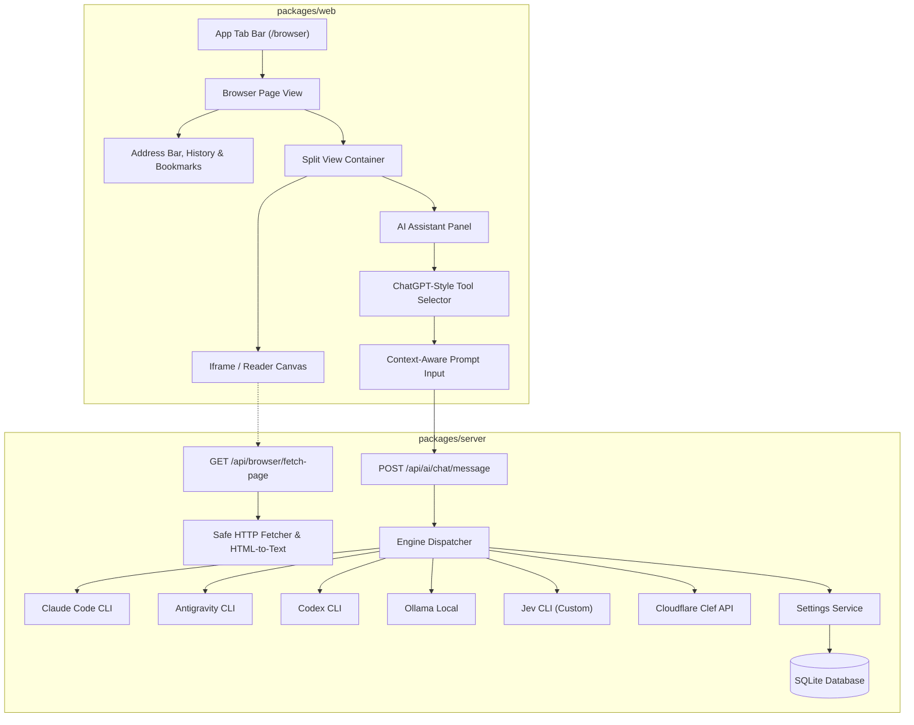

# Built-In Browser with AI Tool Selector & Jev / Clef Engine Configuration Design

## 1. Overview & Goals

This specification defines the architecture, user experience, and backend services for:
1. **In-App Built-In Browser (`/browser`)**: A dedicated browser workspace tab equipped with an address bar, navigation controls, quick local/dev shortcuts, live web rendering with readability/proxy extraction, and a **ChatGPT-style sidecar AI Assistant** featuring an interactive **Tool Selector**.
2. **AI Tool Selector in Browser Chat**: Direct action tools allowing users to:
   - 🔍 **Summarize Page**: Synthesize the active webpage into key takeaways and architectural points.
   - 📑 **Extract Requirement**: Convert webpage documentation or specs into a structured SP-Kickstack requirement/ticket with 1-click creation.
   - 🧪 **Inspect & Explain**: Break down technical concepts, API contracts, and code snippets.
   - 💬 **Ask AI About Page**: Grounded conversational Q&A referencing the page's contents.
   - ⚡ **Engine & Model Switcher**: Fast switching between Claude, AGY, Codex, Ollama, Jev, and Clef.
3. **New Engine Configurations in Settings**:
   - **Cloudflare Clef ("Cleft")**: Fast deterministic error triage, bug classification, and risk evaluation.
   - **Jev Engine ("Jev")**: Custom local CLI binary runner with executable path detection, custom args template, and model presets.

---

## 2. Architecture & Data Flow

---

## 3. UI Components & User Experience

### 3.1 Browser Navigation Bar (`BrowserNavBar.tsx`)
- **Navigation Controls**:
  - `Back` / `Forward` buttons (stateful history list).
  - `Reload` button to refresh webview and extracted text.
  - `Home` button to return to workspace landing or dev server.
- **Address Bar**:
  - Editable URL input field with protocol badge (`https://` or `http://localhost`).
  - Preloaded quick links:
    - `Local Dev Server` (`http://localhost:5173` or `http://localhost:4100`)
    - `React / Vite Docs` (`https://vitejs.dev`)
    - `Tailwind CSS Docs` (`https://tailwindcss.com/docs`)
    - `GitHub` (`https://github.com`)
- **Utility Actions**:
  - `Open in External Browser`: Launches system default browser.
  - `Copy URL`: Copies current address.
  - `Toggle AI Panel`: Collapses/expands the right-hand AI sidebar.

### 3.2 Web Content Canvas
- **Rendering**:
  - Uses `iframe` with `sandbox="allow-scripts allow-same-origin allow-forms"` for live interaction.
  - Fallback / Reader Mode: If an external site disallows iframes (`X-Frame-Options` or strict CSP), the canvas displays a clean reader view with title, URL, and extracted markdown text via `/api/browser/fetch-page`.

### 3.3 Sidecar AI Assistant & Tool Selector (`BrowserAiSidebar.tsx`)
- Contextual header showing the current page domain and read status (`✓ Page content synchronized`).
- **Interactive Tool Selector (Pills Toolbar)**:
  - `[🔍 Summarize]`
  - `[📑 Extract Requirement]`
  - `[🧪 Inspect & Explain]`
  - `[💬 Ask Page]`
  - `[⚡ Engine: Claude / Jev / Clef / ...]`
- **Action Execution**:
  - Clicking a tool populates an optimized prompt template, injects the current page context, and sends it to the selected engine.
  - For `Extract Requirement`, the response includes a **"Create Requirement in Studio"** button that directly opens the requirement creation flow pre-filled with the title, description, and tasks.

---

## 4. Engine Configurations: Clef & Jev

### 4.1 Cloudflare Clef ("Cleft")
- **Purpose**: Ultra-fast deterministic decision model for automated error diagnosis, bug triage (P0–P3), and intent classification.
- **Settings Fields**:
  - `clef_enabled` (boolean): Default `true`.
  - `clef_account_id` (string): Cloudflare Account ID.
  - `clef_api_token` (string): Cloudflare API token.
  - `clef_model` (string): Default `@cf/cloudflare/clef-flash`.
  - `clef_auto_triage` (boolean): Whether to trigger auto-triage on test/build failures.
- **Execution**: Can be queried via Cloudflare Workers AI REST API or fallback to local heuristics if credentials are unset.

### 4.2 Jev CLI Engine ("Jev")
- **Purpose**: Configurable runner for custom developer CLI agent binaries.
- **Settings Fields**:
  - `jev_bin_path` (string): Path to binary (default: `jev`).
  - `jev_model` (string): Default model or agent mode.
  - `jev_args_template` (string): Command format template (e.g. `-p --model {model}`).
- **Detection**:
  - Backend checks if the binary is executable in `$PATH` or specified path and returns `isAvailable: boolean`.
  - Badge in Settings: `✓ Installed on PC` vs `✕ Not Detected`.

---

## 5. Settings Screen Updates (`SettingsPage.tsx`)

1. **AI & Local Engines Tab (`ai`)**:
   - Add **Jev Engine** configuration card alongside Claude, AGY, Codex, and Ollama.
   - Add **Cloudflare Clef Decision Engine** configuration card with account credentials and model selector.
2. **Safety & Governance Tab (`safety`)**:
   - Display auto-triage rules and Clef severity definitions (P0–P3).

---

## 6. Verification & Governance Checklist

- [ ] All new settings typed in `@sp-kickstack/shared` (`types.ts`, `schemas.ts`).
- [ ] Settings persisted in SQLite database via `settingsService.ts`.
- [ ] Zero hardcoded credentials or unconfigurable constants.
- [ ] Desktop module compatibility: Tauri IPC and HTTP origins (`tauri://localhost`, `127.0.0.1:4100`) verified.
- [ ] Tab URL sync: `/browser?url=...` synchronized in URL query parameters and Tab Bar.
- [ ] TypeScript typecheck passes: `npx tsc --noEmit`.
- [ ] All unit and component tests passing.
